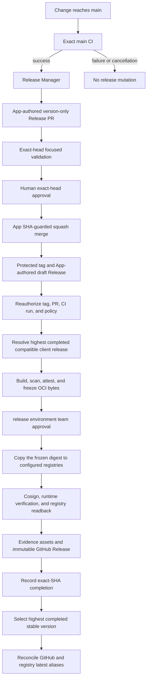

# Release policy

The management service and desktop client have independent stable Semantic
Version sequences. The root `Cargo.toml` is the service version source and
Cargo owns `Cargo.lock`. A client version is a compatibility dependency, not a
shared product version.

The repository implements the organization release baseline with five
responsibility-based workflows: `Main`, `CI`, `Merge`, `Release Manager`, and
`Release`. The stable required check is `CI / Required`.

## State machine

The manager is serialized and idempotent. It recovers one merged
`release:pending` PR before proposing another release. Tag, draft, published,
and completed states are read from GitHub and compared with the exact merge
commit. Missing, duplicated, moved, malformed, or contradictory state fails
closed.

Every version committed in the canonical top Changelog section is permanently
consumed. Deleting a tag or Release does not make the version reusable.

## Authorization

The Release App creates `release/next` with only `Cargo.toml`, `Cargo.lock`, and
`CHANGELOG.md` changes. The PR records the exact validated parent SHA and
successful `Main` run ID. Focused CI regenerates those bytes from the parent and
rejects any other change.

`Merge` proceeds only when all of these remain true:

- the newest non-skipped focused run succeeds for the exact head;
- a current non-bot reviewer with calculated `write` or `admin` permission
  approves that head;
- no current authorized reviewer has an unresolved change request;
- the App-authored proposal, base SHA, labels, title, author, committer, and
  one-parent topology are unchanged;
- repository merge, Actions, and immutable-Release policies still match.

The App performs a SHA-constrained Squash merge. Direct human merge, App
self-approval, merge commits, rebase merge, and native auto-merge do not
authorize publication.

## Candidate freeze and approval

Publication separates evidence construction from production authority:

1. `Authorize` binds the managed tag to the merged Release PR and its exact
   successful CI run.
2. Before entering the `release` environment, `Freeze candidate` resolves the
   highest completed immutable `nexus-client` release, validates its tag and
   release evidence, checks the service/client wire contract at that exact
   commit, and records it as a `compatible-with` dependency.
3. Buildx creates one OCI layout for `linux/amd64`. Trivy scans those exact
   bytes. Syft creates an SPDX SBOM. GitHub OIDC records provenance and SBOM
   attestations for the canonical digest. The formal build does not import or
   export a mutable GitHub Actions build cache.
4. `frozen-release-evidence.json` binds the source commit, CI run, dependency,
   image digest, platform digest, SBOM, provenance, policy revisions, and the
   documented platform exception.
5. The protected `release` environment requires team approval and disallows
   administrator bypass. After approval, the workflow may only publish or
   verify the frozen digest; it does not rebuild it.

The first formal release follows the same path and uses `v1.0.0`; no legacy or
transition release path exists.

## Registry policy

`CONTAINER_REGISTRY_MAP` is the sole registry-selection authority. It maps the
logical repository ID to reviewed `ghcr` and `dockerhub` targets.

- A null target is recorded as `skipped` with reason `not-configured`.
- A configured GHCR target uses the current organization namespace and the
  reviewed repository name.
- A configured Docker Hub target requires both `DOCKERHUB_USERNAME` and
  `DOCKERHUB_TOKEN`; a missing half or pair fails publication.
- Credentials never infer or enable an unreviewed target.
- At least one registry must be configured.

The exact same OCI layout is recursively copied to every configured registry.
Each target receives immutable aliases:

- `X.Y.Z`
- `sha-<full-40-character-release-SHA>`

All targets and aliases must resolve to the single frozen digest. Each registry
reference is keyless-Cosign signed and independently verified against the exact
tag workflow identity, or the trusted `main` recovery identity. Registry
readback results and non-secret verification output are part of release
evidence.

`latest` is a discovery alias only. It is reconciled after completion to the
highest completed immutable stable SemVer and never moves backward during an
older release recovery. Production deployments must use
`registry/repository@sha256:...`, never a mutable tag.

## Signing and certificate scope

This repository publishes a service container, not native desktop or mobile
packages. It must not store Windows PFX, Apple certificates, Android
keystores, or Linux package-signing keys. Native signing priority and identity
policy remain in the organization signing registry for client repositories.

Service image and evidence signing use short-lived GitHub OIDC identities:

- OCI digest: keyless Cosign signature per configured registry;
- provenance and SPDX SBOM: GitHub attestations bound to the digest;
- every GitHub Release evidence asset: a keyless Cosign blob bundle.

Private native certificates are allowed only in repositories that produce
native packages, where the final bytes determine the explicitly reported trust
category. They are not a fallback or requirement for this service.

## Platform policy

The formal service image currently supports `linux/amd64` only.

Exception ID: `nexus-management-amd64-clamav`

- owner: logical release team;
- expiry: 2026-10-31;
- reason: the supported ClamAV integration and restore-tested production
  topology are currently limited to amd64;
- compensating control: CI and formal publication execute the final amd64
  image with the pinned ClamAV service before completion;
- removal condition: ClamAV integration, backup/restore, runtime, and security
  acceptance pass for arm64.

The exception is embedded in every formal `release-evidence.json`; it must be
reviewed before expiry rather than silently becoming permanent.

## Evidence and readback

The immutable GitHub Release contains:

- SPDX SBOM, vulnerability report, provenance and SBOM attestation bundles;
- frozen and final release evidence;
- exact client dependency metadata and the downloaded client release evidence;
- OCI platform metadata and per-registry results;
- non-secret Cosign verification results;
- `SHA256SUMS`;
- one Sigstore bundle for every evidence asset.

Trivy scans the extracted, digest-checked OCI layout. The original OCI archive
remains unchanged as the frozen input later copied to each configured registry.

Before the draft becomes public, the workflow uploads and downloads the exact
asset multiset, verifies checksums, evidence schema, blob signatures, GitHub
attestations, OCI labels, executable version, service runtime, registry
aliases, and image signatures. It then publishes without assigning `latest`,
repeats public readback, records `release-complete:<SHA>`, removes
`release:pending`, and finally reconciles latest.

## Hosted controls and credentials

The production boundary uses GitHub Free features available to a public
organization repository:

| Control | Required state |
| --- | --- |
| Main ruleset | Pull request, code-owner approval, linear history, resolved conversations, required `CI / Required`, no force push or deletion |
| Tag ruleset | Existing `v*` tags cannot be updated or deleted |
| Releases | Immutable Releases enabled |
| Environment | `release` requires the repository release team, prevents self-review, disallows admin bypass, and permits only reviewed `main`/`v*` refs |
| Actions | Full-SHA action pins, read-only default token, Actions cannot approve PRs |
| Merge policy | Squash only, PR title as commit title, blank commit body, branch deletion enabled |

Required Release App configuration:

| Resource | Purpose |
| --- | --- |
| `RELEASE_APP_CLIENT_ID` variable | Select the installed release App |
| `RELEASE_APP_LOGIN` variable | Exact `<app-slug>[bot]` identity derived from the token |
| `RELEASE_APP_PRIVATE_KEY` secret | Mint a repository-scoped installation token |
| `NEXUS_REPOSITORY_MAP` variable | Resolve logical client and management repository names |
| `CONTAINER_REGISTRY_MAP` variable | Resolve reviewed registry targets |

The App has Contents, Pull requests, and Issues read/write plus Metadata and
Administration read. It has no Administration write, Actions, or Workflows
permission. Every checkout disables persisted credentials.

## Recovery

Prefer rerunning the failed job. Do not create replacement tags, Releases, or
aliases manually.

An incomplete publication must retain `release:pending`. Once the immutable
`release-complete:<SHA>` marker has been validated, recovery accepts the
authorizing Release PR immediately before or after that label is removed; the
exact PR identity, reviewed head, approval, merge topology, tag and completion
marker are still revalidated.

To recover an existing managed tag, run the `Release` workflow from `main` with
the original `vX.Y.Z` tag. The `main` workflow is only the trusted control
plane; the original tag commit remains the source and authorization subject.

A draft rerun may restore missing aliases only when they are absent or already
match the frozen digest. A public rerun cannot build or sign new bytes: it must
use the digest recorded in Release notes, verify every configured registry and
asset, and complete any remaining proof/latest reconciliation. Any immutable
alias conflict, untrusted signature, missing recorded digest, or evidence
mismatch requires operator investigation.
