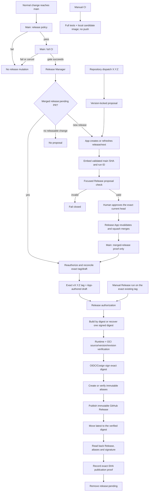

# License-server release policy

Camellia Nexus management-server and client versions advance independently. The server publishes canonical stable Semantic Versions only. `[package].version` in the root `Cargo.toml` is the sole committed version source; Cargo owns `Cargo.lock`.

GitHub Container Registry and the matching GitHub Release are the primary trusted distribution surfaces. Repository owner, repository name, image namespace and OCI source URL are derived from the active GitHub context; the Dockerfile and workflows contain no fixed account or developer-local alternate remote.

Actions names are repository-local and responsibility-based: `Main`, `CI`, `Merge`, `Release Manager` and `Release`. `Gate` remains the stable required check.
Repository-local controls implement the
[organization CI/CD baseline](https://github.com/camellia-computing/.github/blob/main/docs/CI_CD_BASELINE.md);
the organization policy audit detects hosted-setting and required-workflow drift without replacing
the server-specific database, administration and container gates below.

## Release flow



The manager is serialized and idempotent. It recovers the oldest merged `release:pending` PR before proposing another version. Absent, tag-only, draft and published states have explicit transitions; draft creation always precedes tag publication, and a bounded reconciliation advances both resources to a remotely verified prepared state in one invocation. Each mutation is issued once, followed by bounded authoritative observation until its resulting transition is visible; non-convergence and conflicting states fail closed, while an interrupted invocation resumes from the surviving resource. API failures never mean absence, and a moved tag, mismatched Release, rewritten ancestry or duplicate resource stops publication. A public Release remains incomplete until alias/signature readback has produced its exact-SHA `release-complete` marker. Before any mutation, the manager verifies merge, immutable-Release and Actions settings, including full-SHA action pinning and the read-only non-approving workflow-token defaults. Completion remains release-note metadata; [GitHub still permits title and note edits](https://docs.github.com/en/repositories/releasing-projects-on-github/managing-releases-in-a-repository#editing-a-release) after immutable publication while protecting the tag and assets.

Every version recorded by the canonical top Changelog section is permanently consumed. Deleting or losing its tag or Release never makes that version reusable; [GitHub immutable Releases also reserve a published tag name permanently, including after deletion](https://docs.github.com/en/code-security/concepts/supply-chain-security/immutable-releases). The manager treats the commit that introduced the recorded section as the release baseline, considers only later commits for the next version and generated notes, and fails if a same-named tag points elsewhere. A temporary local tag may represent a missing baseline only while git-cliff calculates the next version; it is deleted immediately and is never pushed.

| Observed authoritative state | Required reconciliation |
| --- | --- |
| Pending merged release with no tag and no Release | Create the App-authored draft, then create the exact-SHA tag and re-read both |
| Recorded version without its managed resources and without a pending recovery | Preserve the consumed version and propose only a newer version from commits after its recorded baseline |
| Draft without tag | Create only the exact-SHA tag, then re-read both |
| Tag without Release | Create only the matching App-authored draft, then re-read both |
| Matching tag and draft | Keep `release:pending`; the tag workflow owns digest publication |
| Public Release without completion proof | Recover only its recorded signed digest, verify/restore matching aliases, read back publication and record proof |
| Public Release with completion proof | Remove `release:pending`; a later manager run may propose the next version |
| Conflicting identity/SHA/digest, malformed metadata, API uncertainty or multiple pending releases | Stop without mutation and require operator reconciliation |

## Validation provenance

The focused Release PR path is bound to a successful full `main` validation:

1. `Main` checks the repository merge, immutable-Release and Actions policies in a lightweight `Policy` job, then calls `CI` for the exact `main` SHA.
2. After the reusable `Gate` succeeds, `Release Manager` receives the SHA and current Actions run ID. Only its own current run may temporarily be `in_progress`.
3. The App writes one `release-base` marker and one `release-validation-run` marker into the PR body.
4. The open-PR check allows a short bounded wait for the creating main run to finish, then requires success as a `push` on `main` through `.github/workflows/main.yml` for the exact parent SHA.
5. `release/next` must contain one commit with that parent. GitHub must resolve both its author and committer to the configured App bot identity, which the trusted manager independently derives from the installation token, and its message must be the exact PR title with no body. The focused check recreates `Cargo.toml` and `Cargo.lock` from that parent using the requested version, recreates the dated git-cliff fragment from the same history, and requires byte-for-byte equality with the proposal. No other file or Cargo/changelog edit is accepted. An automatic proposal must equal the calculated minimum version; a version-locked proposal may be higher but cannot be edited below that minimum.
6. `Merge` reacts to either exact-head approval or completion of the focused `CI` run, so their arrival order is irrelevant. For the exact head it selects the newest non-skipped focused workflow attempt across all result pages. A whole-workflow `skipped` run produced while the draft is initialized is not validation evidence; a newer failure, cancellation or in-progress attempt remains authoritative over an older success. Review state is evaluated against each reviewer's current calculated repository permission: only a non-bot user with `write` or `admin` may authorize or block publication. A pending approval or not-yet-successful exact-head `Gate` ends as a clean wait without an App token or candidate checkout. Once both are ready, trusted `main` code revalidates the complete generated proposal and has the Release App submit a SHA-guarded Squash merge. Native GitHub Auto-merge remains disabled.
7. After squash merge, `Main` verifies the merged PR, one-parent topology, markers, exact generated delta, version, exact-head authorized approval and Release App executor identity. Any active authorized change request or merge by another identity blocks tag and draft creation.

Changing a marker, using a failed run, adding another file/commit, updating the base, using a merge commit or changing the author fails closed.

The manager initializes a new proposal as a draft PR, writes its lifecycle labels, and only then marks it ready for review; the focused check therefore never observes a partially initialized contract. It leaves an already-current valid proposal unchanged, preserving its head SHA, checks and review evidence across reruns. When `main` advances, an unlocked proposal is regenerated at the automatic minimum; a locked proposal is regenerated on the new validated base while retaining its App-authored selected version. Existing PR metadata and lifecycle labels are reconciled before the new head is pushed, so the resulting `synchronize` check observes one coherent contract. An interruption before review readiness or between metadata reconciliation and the guarded push is recovered from the App-authored proposal on the validated base; invalid explicit versions are rejected before the open proposal is mutated. A draft event cannot cancel an active review-ready validation; a newer non-draft event still supersedes older work, and a cancelled run never executes `Gate`.

## Test allocation

| Entry | Required work | Intentionally not repeated |
| --- | --- | --- |
| Normal pull request | Rust format/lint/tests, PostgreSQL integration, admin UI/Playwright, dependency audits, then container build and runtime/OCI checks | Registry publication |
| Ordinary `main` push | Same complete gate, then release-manager evaluation | A second container build in the manager |
| Open Release PR | Provenance, App, topology, version and byte-exact regeneration of Cargo/lock/changelog state | Application/database/admin/container suites already proven for its parent |
| Merged Release PR on `main` | Same generated-delta proof against the one-parent release commit, exact-head `write`/`admin` authorization and repository release policy | Full suites and candidate container build |
| Manual `CI` | Complete quality plus a local candidate image tagged by commit | GHCR push and release authority |
| Managed release tag | Managed Release/PR proof, formal image build/recovery, runtime/OCI checks, Cosign and readback | Product test suites already bound to the release parent |

Until the release GitHub App is deliberately configured, an ordinary `main`
push still runs the complete source-validation workflow but skips the policy
and release-manager jobs. Setting either release App variable activates strict
configuration checks; publication remains fail-closed until both variables and
the private-key secret are valid.

`Candidate Image` remains after `Quality`: it validates the final Dockerfile, compiled runtime,
version, revision and dynamically derived source label. Against isolated PostgreSQL it also applies
migrations; starts the public, Admin, and worker roles; completes real administrator enrollment,
login, step-up and logout; creates an account, Team license, activation-code delivery and Team
invitation; verifies retry-safe delivery; and checks the final container hardening. It is not a
duplicate of Rust tests. The supported production image is explicitly `linux/amd64`; this matches
the current ClamAV dependency and avoids publishing untested architecture claims.

## Release PR merge policy

- Use **Squash and merge** for `release/next`.
- Require exact-head approval from a current non-bot reviewer with calculated `write` or `admin` permission and a successful focused `Gate`. The Release App revalidates both and performs the SHA-guarded Squash merge. Read-only reviews, direct human merge, App self-approval and native GitHub Auto-merge do not authorize publication; an active `write`/`admin` change request blocks it.
- Do not use merge commits, retarget, rebase, edit or append commits to the generated branch.
- Delete the branch after merge; the manager recreates it.
- Never create or move `v*` tags manually.

The manager enforces exact-head approval and merge-policy evidence again after merge, so a direct or otherwise unauthorized merge fails closed before tag or Release creation. Restrict write membership and explicitly review workflow-file changes because the workflow definition is part of the trust boundary.

## GitHub App identity

The installation token is the sole authority for the App identity. Release source contains no App name, account, repository owner or developer-local remote identity. The workflow derives and validates:

```text
<app-slug>[bot]
<numeric-bot-id>+<app-slug>[bot]@users.noreply.github.com
```

Every publication authorization and completion boundary repeats the slug-to-login check using the installation token that supplied the Administration-read policy credential.

| Resource | Required value | Security boundary |
| --- | --- | --- |
| Repository variable | `RELEASE_APP_CLIENT_ID=<installed App client ID>` | Selects the installed release App |
| Repository variable | `RELEASE_APP_LOGIN=<app-slug>[bot]` | Must equal the identity derived from the installation token |
| Repository secret | `RELEASE_APP_PRIVATE_KEY=<installed App private key>` | Available only to jobs that mint a scoped installation token |
| Repository labels | `release:pending`, `release:version-locked` | Persist release lifecycle and explicit-version intent |
| App repository permissions | Contents, Pull requests and Issues: read/write; Metadata and Administration: read-only | Permits release mutation and immutable-Release settings verification |
| App forbidden permissions | Administration write, Actions and Workflows | Prevents policy mutation and workflow control by the release identity |
| Installation approval | The repository owner approves the exact permission set | Required before the installation is release-capable |

An exact higher version can be requested through the default-branch `repository_dispatch` entry point. It follows the same provenance, authorization and publication path and does not expose the App private key to a workflow selected from another ref:

```bash
repository="${GH_REPO:-$(gh repo view --json nameWithOwner --jq .nameWithOwner)}"
jq -nc --arg version X.Y.Z \
  '{event_type:"release-request",client_payload:{version:$version}}' |
  gh api -X POST "repos/${repository}/dispatches" --input -
```

Set `GH_REPO` when the working tree has multiple remotes and the target is otherwise ambiguous. The command and workflow contain no fixed owner or account identity.

The isolated `Policy` job and publication authorization steps mint App tokens scoped to Administration read, Contents write and Metadata read. GitHub exposes repository merge policy and App-authored draft Releases only to an appropriately privileged installation token. The token is used only for policy checks and managed Release reads or mutations and is never passed to reusable CI, pull-request or manual candidate runs. Release management validates the same policy again at mutation boundaries, while a read-only workflow token checks Actions provenance.

`Merge` mints its installation token only after approval and exact-head `Gate` readiness, with Administration read, Contents write, Metadata read and Pull requests read. Contents write permits the merge endpoint; the candidate checkout never selects the toolchain or installer, and only trusted `main` release policy executes against it.

Every checkout disables persisted credentials. The release script supplies the current job token only to each remote Git command through an origin-host-bound in-memory credential helper; neither the workflow token nor the App token is written into repository Git configuration or exposed to unrelated build steps. Reusable workflows receive named secrets only, never the caller's complete secret set.

## Image and publication contract

The release image name is `ghcr.io/<current-owner>/camellia-nexus-management-server`. Formal publication creates or verifies these immutable aliases:

- `X.Y.Z`;
- `sha-<full-40-character-release-SHA>`.

All immutable aliases must resolve to one canonical digest. A new image is first pushed by canonical digest without a formal alias. The workflow pulls that digest and verifies the executable version and OCI `version`, `revision` and `source` labels, then signs it before creating any immutable release alias. `source` must equal the current repository URL supplied by GitHub Actions.

This repository publishes a Linux server container, not an end-user native or
mobile application. It must not hold Windows PFX, macOS/iOS certificate,
Android keystore or Linux package-signing secrets. Its release identity is the
keyless Cosign/OIDC workflow identity bound to the immutable OCI digest and
verified provenance. Non-secret native certificate identities for the client
repositories remain centralized in the
[organization signing registry](https://github.com/camellia-computing/.github/blob/main/config/signing-identities.json);
they are deliberately not duplicated here.

The runtime stage performs no package-manager or mutable mirror operation. It copies the required CA bundle and compiled assets from immutable builder inputs, runs as numeric UID/GID `10001:10001`, and uses the application binary itself for local readiness probes.

An existing digest is reusable only if it already has a valid keyless signature from the exact tag workflow or the trusted `main` recovery workflow. The workflow never back-signs an unknown pre-existing digest. Publication records exactly one canonical digest in the managed Release notes before the Release becomes public. Every public rerun is bound to that recorded digest: missing aliases may be restored only after registry availability, workflow identity and signature verification, while a missing or conflicting recorded digest stops the run. A public Release can therefore never enter the image-build path. The mutable `latest` alias is updated only after the immutable digest and GitHub Release are public and only when that tag is still GitHub's current Latest Release. Rerunning a superseded tag cannot roll `latest` back. Production deployments must pin the digest rather than `latest`.

If build, runtime verification or signing fails before alias creation, rerunning the publication safely rebuilds by digest; no formal alias has been claimed. If alias creation is only partially completed, a rerun accepts the digest only after validating the exact tag or trusted recovery-workflow signature and then restores missing aliases. A pre-existing unsigned formal alias remains a conflict and is never back-signed.

## GitHub Free operating model

The flow relies only on capabilities available to the current public repository on GitHub Free: Actions, GitHub App tokens, GHCR, GitHub Releases, variables/secrets, repository-level branch and tag rulesets, protected environments and public Sigstore transparency. The `release` environment requires a non-self team approval and accepts only the configured release refs; the tag ruleset prevents an existing `v*` tag from being moved or deleted. If repository visibility or the hosting plan changes, releases must stop until these hosted controls are revalidated. Private artifact attestations are not treated as an available boundary.

GitHub/GHCR remain trusted primary sources only when the exact tag/SHA, App-authored managed Release, OCI labels, immutable digest and Cosign workflow identity all verify. Keyless signing publishes workflow identity and digest to public transparency services even for private code; approve that disclosure or use an operated compatible Sigstore deployment.

Every release-capable repository must satisfy this contract:

| Control | Required configuration | Enforcement boundary |
| --- | --- | --- |
| Release immutability | Immutable Releases enabled | Verified before release mutation and publication |
| Merge method | Squash merging enabled; merge commits, rebase merging and native auto-merge disabled; the Release App executes only an approved SHA-guarded merge | Verified before product gates and again before release authorization |
| Squash metadata | Commit title is the pull-request title; commit message is blank | Verified before product gates and again before release authorization |
| Branch lifecycle | Head branches are deleted automatically after merge | Repository policy |
| Main branch | Pull request, exact-head code-owner approval, current required gate, linear history, successful CodeQL policy, resolved review threads, and no deletion or force push | Active repository branch ruleset |
| Release tags | Existing `v*` tags cannot be updated or deleted; published immutable Releases additionally lock their associated tags and assets | Active repository tag ruleset plus Release immutability |
| Release environment | Team approval with self-review prevention; only the configured `main` and `v*` release refs may deploy | GitHub environment protection |
| Action integrity | GitHub Actions enabled; repository SHA-pinning policy enabled; every external action uses a full 40-character commit SHA and every container action uses a `sha256` digest | Repository policy plus `scripts/check-version-policy.sh` |
| Workflow token | Default `GITHUB_TOKEN` permission is read-only; Actions cannot create or approve pull requests; each workflow declares its minimum job permissions | Repository policy plus committed workflow definitions |
| Publication gate | The newest non-skipped focused workflow attempt succeeds for the exact final Release PR head, which has a current `write`/`admin` human approval and no active authorized change request | Workflow-enforced publication authorization |
| Release identity | The GitHub App resources and permissions match the identity contract above; its Contents-write token is the sole reader for App-authored draft Release state | Installation-token identity and managed Release validation |
| Administrative access | Repository and package administration is least-privilege; App key rotation replaces the configured key and secret as one operation | Repository administration |
| Deployment identity | `migrate`, `serve`, `admin-web` and `admin-worker` deploy the verified immutable image digest | Deployment policy and release readback |

## Recovery

- Only the newest `Main` run remains active. A newer `main` push cancels superseded validation and manager work; the replacement run revalidates the latest SHA and idempotently reconciles any interrupted proposal, tag or draft transition.
- `Merge` reconciles both approval and focused-run completion events. Approval may arrive before or after `Gate`; the App token and candidate checkout are not created until both are ready, and only the newest non-skipped exact-head focused attempt may authorize the merge. Superseded or already-consumed events exit successfully without mutation.
- Failures before immutable aliases exist can rerun from the draft. Prefer **Re-run failed jobs**; a full rerun is also safe and accepts only a digest signed by the exact tag workflow before restoring missing aliases.
- Existing signed aliases must agree on one digest; disagreement is a conflict.
- A published GitHub Release and immutable aliases are never overwritten.
- A canonical Changelog version is never reused. If its tag or Release is absent and no pending managed recovery owns it, retain the recorded baseline and release later work under the next eligible version.
- Failure while updating `latest` is an operational retry; it does not invalidate immutable publication.
- Rerunning a superseded published tag verifies its immutable aliases and proof but never moves `latest` backwards.
- A published Release without exact-SHA completion proof keeps `release:pending` and blocks the next proposal until the tag workflow completes `latest` and readback.
- Merged Release PR discovery uses the paginated closed-PR endpoint constrained to `main` and the current repository's `release/next` head. A canonical release commit on `main` must resolve, after a bounded visibility wait, to exactly one PR whose `merge_commit_sha` equals the current 40-character SHA; absence or ambiguity fails the run instead of falling back to ordinary CI. Recovery considers records carrying `release:pending` plus the PR at the exact current `main` SHA, rechecks each live label before mutation and permits at most one pending release.
- Pending-label cleanup is retried only after the public Release, aliases and signature pass readback and completion is recorded.
- If Actions quota or an infrastructure interruption stops a run, rerun that same workflow run after capacity returns. Its original tag/SHA remains the authorization subject; do not create a replacement tag, Release or image alias manually.
- Recover an existing managed tag with `gh workflow run publish-release.yml --ref main -f tag=vX.Y.Z`. The workflow on `main` is the control plane, while the exact existing tag commit remains the only image source and authorization subject. Canonical tag, main ancestry, App-authored draft, merged Release PR, repository policy and exact SHA are all revalidated before reuse or mutation.
- Normal publication signatures are bound to the exact tag workflow identity. Manual recovery signatures are bound to the `main` Release workflow identity. Recovery accepts an existing digest from only those two exact identities, never back-signs unknown bytes and keeps the tag, Release and immutable aliases unchanged.

## 中文执行摘要

服务端与客户端版本完全独立。普通变更必须完成 Rust、数据库、管理 UI、Playwright 与容器全量门禁。Release PR 以 `main SHA + 成功 Actions run ID + App author/committer + 单父提交` 证明其父提交已完成全量验证，并从该父提交逐字重建和核对版本清单、锁文件与 Changelog，禁止在白名单文件中夹带其他变更；最终 head 还必须具备当前仓库权限为 `write` 或 `admin` 的非机器账户批准，且没有同等权限审阅者尚未解除的变更请求；只读审阅不具备发布授权力。相同提案的重跑保持 head 与审批不变，`main` 前进时按锁定策略重新生成。因此打开和 squash 合并 Release PR 时只执行聚焦生成证明，不重复高成本测试与候选镜像构建。Changelog 顶部正式版本一经提交即永久占用；标签或 Release 缺失也不得复用。版本计算以该段首次提交为基线，仅纳入后续提交，临时本地基线标签绝不推送。

候选镜像门禁在隔离 PostgreSQL 中执行迁移，启动公开服务、Admin 与 Worker，完成真实的管理员引导、登录、二次验证和注销，并验证账户、Team 授权、激活码安全交付、Team 邀请、幂等重试与最终容器硬化；它验证的是最终镜像边界，并非重复 Rust 单元测试。

GitHub App 身份以真实 installation token 返回的 slug 为唯一权威。工作流据此推导 bot login 与 noreply 邮箱，并强制核对仓库中配置的 Client ID、login 与私钥。发布代码不得包含 App 名称、仓库所有者、账户、来源 URL 或开发机 remote 的特例。

Release PR 最终统一使用 **Squash and merge**；唯一人工操作是批准精确 head。`Merge` 在审批与最新聚焦 `Gate` 均成立后从受信任 `main` 代码复核全部发布证据，再由 Release App 以 SHA 约束自动合并。直接人工合并、App 自我审批、GitHub 原生 auto-merge 及未解除的人工变更请求均不能授权发布。工作流在发布边界再次复核审批、合并策略与不可变 Release 设置。该仓库只发布 Linux 服务端容器，不保存 Windows/macOS/iOS/Android 原生签名秘密；其发布身份是绑定不可变 OCI digest 的无密钥 Cosign/OIDC 工作流身份。正式 tag 构建/恢复一个不可变 digest，验证运行时与动态 OCI 来源标签，仅对新建 digest 签名，发布不可变 GitHub Release 后才更新 `latest`，最后回读 Release、全部别名与 Cosign 签名。既有受管标签的人工恢复始终从 `main` 的 `Release` 工作流输入原标签，当前工作流提交仅作为控制面，实际镜像来源仍固定为原标签 SHA。生产部署始终固定 digest。
